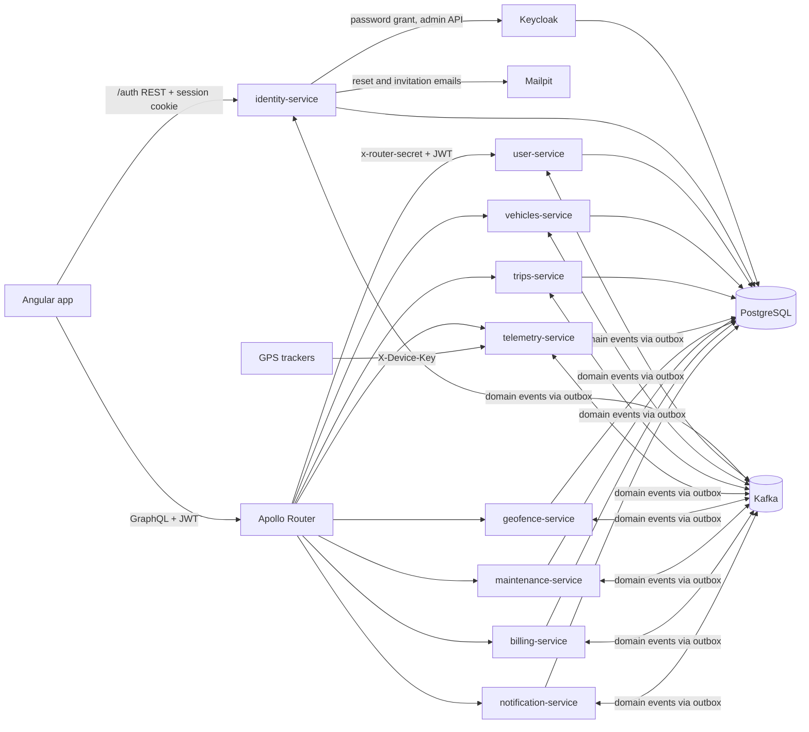

# SmartStreet — Fleet Management Platform

SmartStreet manages a rental and service fleet: vehicles, drivers, customers, the trips that connect them, the workshop that keeps them running and the invoices that pay for them. It is a set of Spring Boot GraphQL subgraphs federated by Apollo Router, an identity service in front of Keycloak, and an Angular front end with its own sign-in, sign-up and account pages.



## Services

| Service | Owns | Publishes | Consumes |
|---|---|---|---|
| `identity-service` | Sign-in, sign-up, session refresh, password reset, staff invitations, profile (REST over Keycloak) | `account.events` | |
| `user-service` | Customers, drivers (licence, status, rating, completed trips), account links | `customer.events`, `driver.events` | `trip.events` (driver busy/free, trip counts), `account.events` (customer self sign-up, driver account link) |
| `vehicles-service` | Vehicles, odometer, maintenance schedule | `vehicle.events` | `trip.events` (vehicle in use), `telemetry.positions` (odometer sync) |
| `trips-service` | Trip lifecycle `SCHEDULED → IN_PROGRESS → COMPLETED / CANCELLED`, costs, route, one-step booking (pickup, destination, optional departure) with automatic vehicle and driver assignment and a price quote | `trip.events` | `vehicle.events`, `driver.events` (local availability projection) |
| `telemetry-service` | Tracking devices, position history, latest position per vehicle | `telemetry.positions` | `vehicle.events` (known vehicles, revoke devices of deleted vehicles) |
| `geofence-service` | Zones (polygon or circle), occupancy, alerts | `geofence.events` | `telemetry.positions` |
| `maintenance-service` | Work orders `SCHEDULED → IN_PROGRESS → COMPLETED / CANCELLED`, parts and labour costs, automatic preventive orders, overdue flags | `maintenance.events` | `vehicle.events` |
| `billing-service` | Income: invoices drafted from completed trips, `DRAFT → ISSUED → PAID / VOID`, 19 % VAT, payment terms, overdue detection. Outcome: expenses from completed work orders and driver salaries accrued every 30 days from the hire date | `billing.events` | `trip.events`, `customer.events`, `maintenance.events`, `driver.events` |
| `notification-service` | Per-user inbox with read state, audience routing (staff, driver, customer), licence expiry reminders | | `geofence.events`, `maintenance.events`, `trip.events`, `billing.events`, `vehicle.events`, `driver.events`, `customer.events` |
| `shared` | Security, GraphQL error mapping, event contracts, transactional outbox, Kafka dead-lettering | | |

Key rules enforced by the backend:

- A trip can only use an `ACTIVE` vehicle and an `ACTIVE` driver, and never overlaps another active trip for either. The service checks this, and PostgreSQL exclusion constraints guarantee it under concurrency.
- Vehicles and drivers on a trip cannot be deleted or taken out of service.
- Odometer readings never go backwards. Starting a work order takes the vehicle out of service and completing it brings the vehicle back with a fresh maintenance date.
- A vehicle within 7 days of its next service gets a preventive work order automatically.
- Every completed trip with a cost gets exactly one draft invoice. Customers only ever see issued invoices of their own account.
- Geofence alerts follow the zone kind: leaving a service area or entering a restricted area is critical, depots are informational, and speeding inside a zone with a limit is a warning (at most one every 10 minutes per vehicle).
- Every state change is written to an outbox table in the same transaction and relayed to Kafka. Consumers are idempotent, and failed records go to `<topic>.DLT` after retries.
- Driver salaries accrue every 30 days from the hire date (`PayCycle` in `shared`) and show up as expenses on the billing *Outcome* tab.

### Trip booking

Customers and staff book a trip in one step: pick a pickup and a destination on the map, optionally a departure time, and `requestTrip` assigns a free `ACTIVE` vehicle and driver. `tripQuote` prices the trip before it is confirmed with a base fare plus a rate per kilometre. The defaults are 8.000 and 0.850, and you can override them with `TRIP_BASE_FARE` and `TRIP_PRICE_PER_KM` on `trips-service`. The duration estimate adds a handover margin to the travel time.

The front end calls two public services directly, with URLs set in `frontend/src/environments`:

| Purpose | Default |
|---|---|
| Address search (geocoding) | Photon, `https://photon.komoot.io` |
| Driving routes | OSRM demo server, `https://router.project-osrm.org` |

Both are rate-limited public demos, so point them at your own instances in production.

## Quick start

Prerequisites: Docker, Node.js 22, and Java 21 with Maven if you build outside Docker.

```bash
docker compose up -d --build
```

Run this from the repository root. It reads `.env` from the same folder; to start from scratch, copy `.env.example` to `.env` and fill in every value (`openssl rand -hex 32` works for `ROUTER_SECRET`). Compose refuses to start while a required value is missing.

Keycloak stores its data in the `keycloak` PostgreSQL database and imports the `Smart-Street` realm on first start (`deploy/keycloak/import/Smart-Street-realm.json`). The realm holds the confidential `smartstreet-identity` client used by the identity service, the roles `ADMIN`, `MANAGER`, `DRIVER` and `USER`, and these development accounts:

| Email | Password | Roles |
|---|---|---|
| fleet-admin@smartstreet.local | admin12345 | Administrator, fleet manager |
| fleet-manager@smartstreet.local | manager12345 | Fleet manager |
| fleet-driver@smartstreet.local | driver12345 | Driver |
| customer@smartstreet.local | customer12345 | Customer |

Users never see Keycloak pages: sign-in, sign-up, password reset, account activation and profile editing all happen in the Angular app through `identity-service`. The access token stays in memory and the refresh token in an `HttpOnly`, `SameSite=Strict` cookie scoped to `/auth`. Emails (password reset, invitations) are caught by Mailpit.

```bash
cd frontend
npm ci
npm start
```

| URL | What |
|---|---|
| http://localhost:4200 | Web application (the dev server proxies `/graphql` and `/auth`, see `frontend/proxy.conf.json`) |
| http://localhost:4000/graphql | Federated GraphQL API (bearer token required) |
| http://localhost:8086/auth | Identity API |
| http://localhost:8025 | Mailpit inbox for password reset and invitation emails |
| http://localhost:8085/ingest/v1/positions | Device position ingestion (`X-Device-Key` header) |
| http://localhost:8083 | Keycloak admin console (credentials from `.env`) |

### Live tracking demo

1. Open a vehicle, choose **Add device** under *Live tracking*, and copy the key that is shown once.
2. Run the simulator with one `--device` per key:

   ```bash
   node tools/telemetry-simulator/simulate.mjs --device ssd_xxx --device ssd_yyy
   ```

3. Watch the vehicles move on **Live map**. Draw zones under **Geofences** to see alerts appear.

The schema is managed by Flyway. A one-shot `databases` container creates any missing database on every start, so new services also work on an existing volume. If you have a volume from a much older version, recreate it with `docker compose down -v`.

## Security model

- The router turns away any operation without a bearer token (`rhai/main.rhai`), and the Spring subgraphs verify the Keycloak JWT signature, expiry and roles on every request. It only accepts browser calls from `FRONTEND_ORIGIN`, and introspection is disabled.
- `identity-service` is the only component that talks to Keycloak. Reset and invitation links carry single-use tokens stored as SHA-256 hashes (30 minutes and 72 hours), forgotten-password requests never reveal whether an email exists, and setting a new password signs the account out everywhere.
- Subgraphs are not published on the host. Each one requires the router's `x-router-secret` (compared in constant time) and validates the JWT itself.
- Resolvers enforce realm roles with `@AdminOnly`, `@ManagerOrAdmin` and `@Staff` from the shared module.
- Tracking devices never get user tokens. They authenticate on the ingestion endpoint with a per-device key that is shown once and stored only as a SHA-256 hash; revoking it, or deleting the vehicle, cuts the device off.
- Secrets live only in `.env`, which is git-ignored. CI runs Gitleaks on every push.

## Development

Backend (from `backend`):

```bash
mvn verify
```

`mvn verify` runs unit tests plus Testcontainers integration tests (PostgreSQL, Kafka, and Keycloak with Mailpit for the identity service), so Docker must be running. The identity test imports the realm file from `deploy/`, so run it from a full checkout.

Changing a subgraph schema (from `backend/services/api-gateway`):

```bash
npm ci
npm run compose
```

This recomposes `supergraph.graphql`; CI runs `npm run check` to keep it in sync. Then regenerate the typed client in the front end with `npm run codegen`.

Frontend (from `frontend`):

```bash
npm run lint
npm run test:ci
npm run build
```

## Repository layout

```
docker-compose.yml           full stack (reads .env)
.env.example                 required settings
deploy/                      Keycloak realm, database bootstrap script
backend/
  Dockerfile                 one image definition, built per service with --build-arg SERVICE
  pom.xml                    parent POM (Spring Boot 3.5, DGS 10, MapStruct)
  services/
    shared/                  security, outbox, Kafka, GraphQL errors, event contracts
    user-service/            api · application · domain · infrastructure
    vehicles-service/
    trips-service/
    telemetry-service/
    geofence-service/
    identity-service/        REST BFF for sign-in, sign-up, passwords, invitations, profile
    maintenance-service/
    billing-service/
    notification-service/
    api-gateway/             router.yaml, rhai, supergraph composition
frontend/                    Angular 20 (zoneless, signals, OnPush, generated Apollo services, Material 3, 4 languages with RTL)
tools/telemetry-simulator/   demo GPS feed
.github/workflows/ci.yml     secrets scan, backend verify, supergraph check, frontend lint/test/build, images
```
